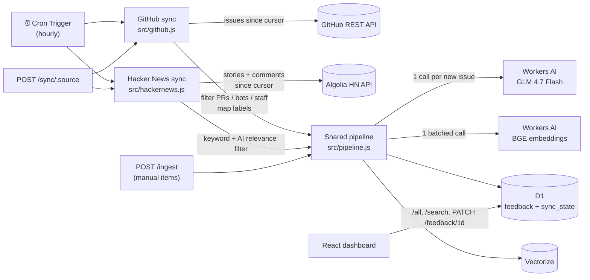

# Cloudflare Voice: Real Feedback Edition

A copy of the [Cloudflare Voice feedback dashboard](https://github.com/apurva-mali/cloudflare-dashboard). This version runs on **real public feedback** instead of synthetic data, from two sources:

- **GitHub Issues** from Cloudflare's open-source repos: [`workers-sdk`](https://github.com/cloudflare/workers-sdk), [`workerd`](https://github.com/cloudflare/workerd), [`cloudflare-docs`](https://github.com/cloudflare/cloudflare-docs) and [`agents`](https://github.com/cloudflare/agents). This brings structured bug reports, feature requests and docs gaps.
- **Hacker News** stories and comments that discuss Cloudflare products. This brings opinions, including praise, which GitHub issues almost never contain.

## The dashboard

| Tab | What it's for |
|---|---|
| **Overview** | Sentiment index and balance bar (click a segment to read those items), key numbers, "Needs attention" and "What people like", feedback over time, sentiment by product, most-mentioned themes |
| **Inbox** | Everything nobody has looked at yet, most urgent first. List on the left, full detail and actions on the right, keyboard shortcuts (`j`/`k` move, `r` reviewed, `s` star, `t` ticket, `x` resolve, `d` dismiss, `h` highlight, `o` open, `?` help). Built to clear a day's feedback in a few minutes |
| **Feedback** | The full log: sort, page, filter, star, search by exact words or by *similar meaning* (Vectorize). Click a row for the detail panel |
| **Themes** | Feedback about the same thing, grouped automatically (e.g. three reports of the same R2 ETag bug). Raise one ticket for a whole theme |
| **Highlights** | A library of praise saved with a purpose: *Customer story*, *Launch quote*, *Team shout-out*, *Competitive win*. Copy a quote with attribution and link in one click |
| **Products** | Each product's volume, sentiment balance, index, urgent count, open tickets, top concern and top praise |
| **Digest** | A weekly summary per product, written every Monday: what people talked about, change from the week before, themes, urgent items, praise. "Copy as text" for Slack or email |
| **Tickets** | Support tickets (CV-1, CV-2, …) with inline priority, assignee and status. Resolving a ticket resolves its feedback, or its whole theme. "Author not told" lists resolved tickets nobody has replied about yet |

**Actions fit the feedback.** Problems (negative and neutral) get *Raise ticket*, *Resolve* and *Dismiss* (with a reason: duplicate, not actionable, off-topic, spam). Praise gets *Save to highlights* instead, because there's nothing to resolve. Anything can be *starred* to come back to, *marked reviewed* to leave the inbox, and given **team notes**.

**Closing the loop.** When a GitHub issue is closed upstream but still open here, the detail panel says so and offers *Mark resolved*. Once something is resolved, it prompts you to reply to the author on GitHub or Hacker News and to mark it replied, and the Tickets tab tracks which resolved tickets still need a reply.

**Shareable views.** The URL always holds the tab, time range, filters, search and open item, so *Copy link* (in the filter bar, or on any item) sends someone exactly what you're looking at.

The time range and filters apply to every tab except Digest and Tickets. Tables choose their columns by screen width, so nothing scrolls sideways, down to phone size.

## Why GitHub Issues first

GitHub issues come with structure that free text from social sites doesn't have:

| GitHub signal | Dashboard field | How |
|---|---|---|
| `product:d1`, `r2`, `pages`, `package:wrangler`, … labels | **Product Category** | Deterministic label map; AI only fills gaps |
| `bug` / `regression` / `enhancement` / `documentation` / `question` | **Feedback Type** | Deterministic |
| `priority: p0`, `regression`, `breaking change`, ≥20 reactions | **Urgency** | Deterministic; AI otherwise |
| `author_association` | **User Type** (Community / Contributor) | Deterministic. Cloudflare staff issues are skipped as internal |
| Title and body | **Sentiment, NPS, Summary, Recommended Action** | Workers AI |
| `html_url`, `state`, `reactions`, `comments` | New provenance columns | Stored and refreshed on every sync |

Because so much comes straight from labels, the model has much less to guess. Categories stay consistent from run to run.

## Why Hacker News as the second source

GitHub issues are mostly complaints, by design. Hacker News is where developers also say what they like (pricing, speed, developer experience), so it balances the dashboard. It's also free and needs no API key, through the [Algolia HN Search API](https://hn.algolia.com/api).

HN is noisier, so every candidate passes two filters before it's stored:

1. **A keyword check, with no AI cost.** The text must name a Cloudflare product and be long enough to say something.
2. **The AI's `relevant` flag.** It rejects comments that only mention Cloudflare in passing or as news (for example "Cloudflare had an outage again").

Rejected items are remembered in `skipped_items`, so they're never analyzed again. Each run searches the queries in `HN_QUERIES` (stories and comments), combines and dedupes the results, and processes them oldest first, up to `HN_MAX_NEW_PER_RUN` AI calls.

## Sentiment scoring

Sentiment is a 1–10 *mood* score, where 5 means neutral. It's grouped as **Detractor (1–4)**, **Passive (5–7)** and **Promoter (8–10)**. The dashboard's "Sentiment Index" is % Promoters minus % Detractors, from −100 to +100.

The first version copied NPS's 0–6 cutoff for Detractor. That was wrong for a mood scale, because it counted neutral feedback as negative. `migrations/0001_hackernews_and_scoring.sql` recalculates existing rows.

## Architecture



**How a sync run works (`src/github.js`):**

1. For each repo in `GITHUB_REPOS`, it reads issues updated since the saved cursor, oldest first. A first run looks back `GITHUB_BACKFILL_DAYS`.
2. Issues already stored only get their metadata refreshed (state, reactions, comments, labels). There is no second AI call for them.
3. New issues go through a filter that drops pull requests, bots, and staff (`OWNER`, `MEMBER`, `COLLABORATOR`). Their bodies are cleaned (template comments, code and log blocks, and images removed) and then analyzed.
4. Each run analyzes at most `GITHUB_MAX_NEW_PER_RUN` new issues. The cursor only moves past issues that were fully handled, so nothing is skipped when a run hits its cap. The next run continues where this one stopped.
5. `external_id` (e.g. `gh:cloudflare/workers-sdk#1234`) is `UNIQUE` in D1, so an issue can never be stored twice.

Embeddings, D1 writes and Vectorize writes are batched. Each run uses roughly one subrequest per new issue plus a handful of fixed ones, which fits within Workers' per-invocation limits.

## API

| Method | Path | Auth | Purpose |
|---|---|---|---|
| GET | `/all` | none | All feedback rows (labels returned as an array) |
| GET | `/search?q=` | none | Semantic search via Vectorize |
| GET | `/sync/status` | none | Cursor and last run result per stream |
| POST | `/sync/github?max=N&since_days=N` | `ADMIN_TOKEN` | Run the GitHub sync now. `max` overrides the per-repo cap; `since_days` re-scans further back once (nothing is duplicated or re-analyzed) |
| POST | `/sync/hackernews?max=N` | `ADMIN_TOKEN` | Run the Hacker News sync now |
| POST | `/sync/themes?max=N` | `ADMIN_TOKEN` | Group up to N not-yet-grouped items into themes |
| POST | `/sync/all?max=N` | `ADMIN_TOKEN` | Run every source, then themes (this is what the hourly cron does) |
| POST | `/ingest` | `ADMIN_TOKEN` | Ingest one manual item (same body as the original project) |
| PATCH | `/feedback/:id` | none | Any of `feedback_status` (`Open` \| `Ticket Raised` \| `Resolved` \| `Dismissed` + `dismissed_reason`), `starred`, `reviewed`, `highlight_tags` (string array), `responded` |
| POST | `/feedback/bulk` | none | `{ids: [...≤200], changes: {...}}`, e.g. mark a backlog reviewed |
| GET / POST | `/feedback/:id/notes` | none | List or add team notes (`{body, author?}`) |
| DELETE | `/notes/:id` | none | Delete a note |
| GET | `/themes` | none | Themes with at least two items, with ticket status |
| GET | `/digests[?week=YYYY-MM-DD]` | none | One weekly digest plus the list of available weeks |
| POST | `/digests/generate` | none | Build the current week's digest now (rebuilt at most every 10 minutes) |
| GET | `/tickets` | none | All tickets, with source, link and product from the linked feedback |
| POST | `/tickets` | none | `{feedback_id, title, priority: "P0"–"P3", team?, assignee?, description?, theme_id?}`. One ticket per feedback item and per theme (409 if one exists) |
| PATCH | `/tickets/:id` | none | Any of `status` (`Open` \| `In Progress` \| `Resolved`), `priority`, `assignee`, `team`, `title`, `description` |

`ADMIN_TOKEN` is sent as `Authorization: Bearer <token>`. If the secret isn't set (typical for local dev), these routes are open.

## Setup

Prerequisites: Node 20+, a Cloudflare account, and `npx wrangler login`.

```bash
npm install
npm --prefix frontend install

# 1. Create this project's own D1 database and Vectorize index
#    (separate from the original dashboard's, so that one keeps its data)
npx wrangler d1 create feedback-github-db
#    → paste the printed database_id into wrangler.jsonc
npx wrangler vectorize create feedback-github-index --dimensions=768 --metric=cosine
npm run db:init:remote          # applies schema.sql

# 2. Secrets
npx wrangler secret put GITHUB_TOKEN   # fine-grained PAT, "Public repositories (read-only)"
npx wrangler secret put ADMIN_TOKEN    # any long random string

# 3. Build the dashboard and deploy
npm run build
npm run deploy

# 4. Trigger a first sync instead of waiting for the hourly cron
curl -X POST "https://cloudflare-github-feedback.<your-subdomain>.workers.dev/sync/all?max=15" \
  -H "Authorization: Bearer $ADMIN_TOKEN"
```

### Upgrading an existing deployment

```bash
git pull
npm run db:migrate      # applies any migrations/ not yet applied, and records them
npm run build && npm run deploy
```

`db:migrate` uses Wrangler's tracked migrations, so each file runs exactly once. On a database where 0001 and 0002 were applied by hand earlier, they run once more harmlessly (they only create missing tables).

To pull in more history after adding repos or raising the lookback:

```bash
for i in 1 2 3 4 5; do curl -s -X POST "$APP_URL/sync/github?max=40" -H "Authorization: Bearer $ADMIN_TOKEN"; echo; done
curl -s -X POST "$APP_URL/sync/github?since_days=60&max=40" -H "Authorization: Bearer $ADMIN_TOKEN"   # one-off deeper look for repos that were already syncing
for i in 1 2 3 4; do curl -s -X POST "$APP_URL/sync/themes" -H "Authorization: Bearer $ADMIN_TOKEN"; echo; done   # group existing items
```

### Local development

```bash
cp .dev.vars.example .dev.vars     # add GITHUB_TOKEN (optional) there
npm run db:init                    # local D1
npm run dev                        # Worker on :8787 (Workers AI and Vectorize run remotely)
curl -X POST localhost:8787/sync/github?max=5
npm --prefix frontend run dev      # dashboard on :5173, proxied to :8787
```

To test the cron handler locally, run `npx wrangler dev --test-scheduled` and then `curl "localhost:8787/cdn-cgi/handler/scheduled?cron=17+*+*+*+*"`.

The original synthetic items can still be loaded alongside the real data: `npm run load-data` (they come in through `/ingest`, so set `ADMIN_TOKEN` in your shell if you've configured one).

### Tests

```bash
npm test
```

The tests run in Node against the real `schema.sql`. D1, Workers AI, Vectorize and the GitHub API are replaced with in-memory fakes, so no Cloudflare account or network access is needed. They cover:

- label mapping and issue filtering
- model-output parsing and the defaults used when the AI fails
- budgeted, resumable, duplicate-free syncing for both sources, including GitHub metadata refresh
- HN HTML cleanup, keyword and AI relevance filtering, and recovery when the HN API is down
- the sentiment buckets
- admin auth on write routes and persisted ticket status
- triage actions (star, reviewed, dismiss with reason, highlights, replied), bulk updates and notes
- themes: grouping within a batch and through Vectorize, titles, theme tickets that never touch dismissed items, and that HN thread titles or issue templates can't create false themes
- weekly digests: week boundaries, counts and changes, urgent and praise picks, cron routing and regeneration throttling
- per-repo GitHub budgets, docs-repo defaults and duplicate-free deeper backfills
- that applying `migrations/` to the first deployed schema gives exactly `schema.sql`

## Configuration (`wrangler.jsonc` → `vars`)

| Var | Default | Notes |
|---|---|---|
| `GITHUB_REPOS` | `workers-sdk, workerd, cloudflare-docs, agents` | Comma-separated `owner/repo` |
| `GITHUB_BACKFILL_DAYS` | `60` | How far back a repo's *first* sync looks; repos already syncing keep their place (use `since_days` for a one-off deeper look) |
| `GITHUB_MAX_NEW_PER_REPO` | `15` | AI calls per repo per run, so a busy repo can't starve the others |
| `GITHUB_INCLUDE_STAFF` | `false` | Include issues opened by Cloudflare org members |
| `HN_QUERIES` | 8 product queries | Comma-separated. Stories and comments are both searched |
| `HN_BACKFILL_DAYS` | `7` | First run only |
| `HN_MAX_NEW_PER_RUN` | `15` | Upper bound on AI calls per run, including items the AI rejects |
| `THEME_SIMILARITY` | `0.85` | How alike two items must be (cosine) to share a theme. Raise it if unrelated items get grouped; lower it if obvious duplicates stay apart |
| `THEME_BATCH` | `40` | Items grouped per run (existing items are backfilled in batches) |
| `AI_MODEL` | `@cf/zai-org/glm-4.7-flash` | The original's `@cf/meta/llama-3-8b-instruct` was [deprecated on Workers AI on 2026-05-30](https://developers.cloudflare.com/changelog/post/2026-05-08-planned-model-deprecations/) |

Changes from the original project:

- Its own Worker name, D1 database and Vectorize index.
- Removed the Wrangler log files (they contained account details).
- Moved the PRD to `docs/` and the synthetic data loader to `scripts/`.
- The dashboard now calls its API on the same origin, instead of a hardcoded `localhost:8787`.

## Known limitations and next steps

- **Region** is always "Unknown", because neither GitHub nor HN exposes author location.
- **GitHub feedback still skews negative**, since issue trackers are mostly bug reports. Filter by source to compare like with like.
- **HN pagination is capped** at 600 results per query per run. That's plenty for these queries, but a very broad query (for example just `cloudflare`) could miss items in a busy week.
- **No dashboard auth.** Anyone with the URL can view the dashboard and change statuses. Put it behind Cloudflare Access before sharing it.
- **Theme quality depends on `THEME_SIMILARITY`.** 0.85 is a starting point for the BGE embeddings; check the Themes tab after a few days and adjust. Themes never merge with each other, and an item stays in the theme it first joined.
- **Workers AI usage** grows with the extra repos: up to 15 analyses per repo per hour while catching up, then only what's new. That's well within the free daily allowance for normal volumes, but check your usage after the first day.
- **Tickets live in D1 only.** A natural next step is also pushing them to GitHub Issues or Jira and storing the external link on the ticket.
- **More sources.** `src/pipeline.js` doesn't depend on the source, so Stack Overflow or the Cloudflare Community forum would each be another fetcher module like `src/hackernews.js`, registered in `SYNCS` in `src/index.js`.
