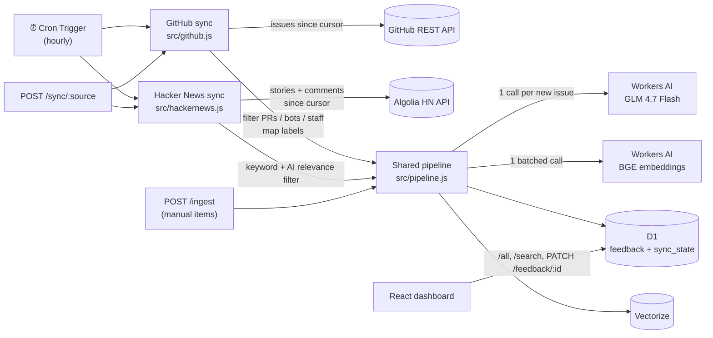

# Cloudflare Voice: Real Feedback Edition

A copy of the [Cloudflare Voice feedback dashboard](https://github.com/apurva-mali/cloudflare-dashboard). This version runs on **real public feedback** instead of synthetic data, from two sources:

- **GitHub Issues** from Cloudflare's open-source repos (by default [`cloudflare/workers-sdk`](https://github.com/cloudflare/workers-sdk)). This brings structured bug reports and feature requests.
- **Hacker News** stories and comments that discuss Cloudflare products. This brings opinions, including praise, which GitHub issues almost never contain.

The dashboard itself (Feedback Log, KPI Dashboard, Clustered Issues, semantic search) is unchanged. What's new is a scheduled ingestion layer in front of it, plus a few dashboard additions:

- links back to each GitHub issue
- the issue's labels, reactions, comments and open/closed state
- "Raise Ticket" and "Resolve" now save to D1 instead of resetting on reload

## Why GitHub Issues first

GitHub issues come with structure that free text from social sites doesn't have:

| GitHub signal | Dashboard field | How |
|---|---|---|
| `product:d1`, `r2`, `pages`, `package:wrangler`, … labels | **Product Category** | Deterministic label map; AI only fills gaps |
| `bug` / `regression` / `enhancement` / `documentation` / `question` | **Feedback Type** | Deterministic |
| `priority: p0`, `regression`, `breaking change`, ≥20 reactions | **Urgency** | Deterministic; AI otherwise |
| `author_association` | **User Type** (Community / Contributor) | Deterministic. Cloudflare staff issues are skipped as internal |
| Title and body | **Sentiment, NPS, Summary, Recommended Action** | Workers AI |
| `html_url`, `state`, `reactions`, `comments` | New provenance columns | Stored and refreshed on every sync |

Because so much comes straight from labels, the model has much less to guess. Categories stay consistent from run to run.

## Why Hacker News as the second source

GitHub issues are mostly complaints, by design. Hacker News is where developers also say what they like (pricing, speed, developer experience), so it balances the dashboard. It's also free and needs no API key, through the [Algolia HN Search API](https://hn.algolia.com/api).

HN is noisier, so every candidate passes two filters before it's stored:

1. **A keyword check, with no AI cost.** The text must name a Cloudflare product and be long enough to say something.
2. **The AI's `relevant` flag.** It rejects comments that only mention Cloudflare in passing or as news (for example "Cloudflare had an outage again").

Rejected items are remembered in `skipped_items`, so they're never analyzed again. Each run searches the queries in `HN_QUERIES` (stories and comments), combines and dedupes the results, and processes them oldest first, up to `HN_MAX_NEW_PER_RUN` AI calls.

## Sentiment scoring

Sentiment is a 1–10 *mood* score, where 5 means neutral. It's grouped as **Detractor (1–4)**, **Passive (5–7)** and **Promoter (8–10)**. The dashboard's "Sentiment Index" is % Promoters minus % Detractors, from −100 to +100.

The first version copied NPS's 0–6 cutoff for Detractor. That was wrong for a mood scale, because it counted neutral feedback as negative. `migrations/0001_hackernews_and_scoring.sql` recalculates existing rows.

## Architecture



**How a sync run works (`src/github.js`):**

1. For each repo in `GITHUB_REPOS`, it reads issues updated since the saved cursor, oldest first. A first run looks back `GITHUB_BACKFILL_DAYS`.
2. Issues already stored only get their metadata refreshed (state, reactions, comments, labels). There is no second AI call for them.
3. New issues go through a filter that drops pull requests, bots, and staff (`OWNER`, `MEMBER`, `COLLABORATOR`). Their bodies are cleaned (template comments, code and log blocks, and images removed) and then analyzed.
4. Each run analyzes at most `GITHUB_MAX_NEW_PER_RUN` new issues. The cursor only moves past issues that were fully handled, so nothing is skipped when a run hits its cap. The next run continues where this one stopped.
5. `external_id` (e.g. `gh:cloudflare/workers-sdk#1234`) is `UNIQUE` in D1, so an issue can never be stored twice.

Embeddings, D1 writes and Vectorize writes are batched. Each run uses roughly one subrequest per new issue plus a handful of fixed ones, which fits within Workers' per-invocation limits.

## API

| Method | Path | Auth | Purpose |
|---|---|---|---|
| GET | `/all` | none | All feedback rows (labels returned as an array) |
| GET | `/search?q=` | none | Semantic search via Vectorize |
| GET | `/sync/status` | none | Cursor and last run result per stream |
| POST | `/sync/github?max=N` | `ADMIN_TOKEN` | Run the GitHub sync now (optionally override the per-run cap) |
| POST | `/sync/hackernews?max=N` | `ADMIN_TOKEN` | Run the Hacker News sync now |
| POST | `/sync/all?max=N` | `ADMIN_TOKEN` | Run every source (this is what the hourly cron does) |
| POST | `/ingest` | `ADMIN_TOKEN` | Ingest one manual item (same body as the original project) |
| PATCH | `/feedback/:id` | none | `{"feedback_status": "Open" \| "Ticket Raised" \| "Resolved"}` |

`ADMIN_TOKEN` is sent as `Authorization: Bearer <token>`. If the secret isn't set (typical for local dev), these routes are open.

## Setup

Prerequisites: Node 20+, a Cloudflare account, and `npx wrangler login`.

```bash
npm install
npm --prefix frontend install

# 1. Create this project's own D1 database and Vectorize index
#    (separate from the original dashboard's, so that one keeps its data)
npx wrangler d1 create feedback-github-db
#    → paste the printed database_id into wrangler.jsonc
npx wrangler vectorize create feedback-github-index --dimensions=768 --metric=cosine
npm run db:init:remote          # applies schema.sql

# 2. Secrets
npx wrangler secret put GITHUB_TOKEN   # fine-grained PAT, "Public repositories (read-only)"
npx wrangler secret put ADMIN_TOKEN    # any long random string

# 3. Build the dashboard and deploy
npm run build
npm run deploy

# 4. Trigger a first sync instead of waiting for the hourly cron
curl -X POST "https://cloudflare-github-feedback.<your-subdomain>.workers.dev/sync/all?max=15" \
  -H "Authorization: Bearer $ADMIN_TOKEN"
```

### Upgrading an existing deployment

If you deployed before Hacker News was added:

```bash
git pull
npm run db:migrate:remote   # adds skipped_items, re-buckets sentiment on existing rows
npm run build && npm run deploy
```

### Local development

```bash
cp .dev.vars.example .dev.vars     # add GITHUB_TOKEN (optional) there
npm run db:init                    # local D1
npm run dev                        # Worker on :8787 (Workers AI and Vectorize run remotely)
curl -X POST localhost:8787/sync/github?max=5
npm --prefix frontend run dev      # dashboard on :5173, proxied to :8787
```

To test the cron handler locally, run `npx wrangler dev --test-scheduled` and then `curl "localhost:8787/cdn-cgi/handler/scheduled?cron=17+*+*+*+*"`.

The original synthetic items can still be loaded alongside the real data: `npm run load-data` (they come in through `/ingest`, so set `ADMIN_TOKEN` in your shell if you've configured one).

### Tests

```bash
npm test
```

The tests run in Node against the real `schema.sql`. D1, Workers AI, Vectorize and the GitHub API are replaced with in-memory fakes, so no Cloudflare account or network access is needed. They cover:

- label mapping and issue filtering
- model-output parsing and the defaults used when the AI fails
- budgeted, resumable, duplicate-free syncing for both sources, including GitHub metadata refresh
- HN HTML cleanup, keyword and AI relevance filtering, and recovery when the HN API is down
- the sentiment buckets
- admin auth on write routes and persisted ticket status

## Configuration (`wrangler.jsonc` → `vars`)

| Var | Default | Notes |
|---|---|---|
| `GITHUB_REPOS` | `cloudflare/workers-sdk` | Comma-separated. Good additions: `cloudflare/workerd`, `cloudflare/cloudflare-docs`, `cloudflare/agents` |
| `GITHUB_BACKFILL_DAYS` | `14` | First run only |
| `GITHUB_MAX_NEW_PER_RUN` | `15` | Upper bound on LLM calls per run |
| `GITHUB_INCLUDE_STAFF` | `false` | Include issues opened by Cloudflare org members |
| `HN_QUERIES` | 8 product queries | Comma-separated. Stories and comments are both searched |
| `HN_BACKFILL_DAYS` | `7` | First run only |
| `HN_MAX_NEW_PER_RUN` | `15` | Upper bound on AI calls per run, including items the AI rejects |
| `AI_MODEL` | `@cf/zai-org/glm-4.7-flash` | The original's `@cf/meta/llama-3-8b-instruct` was [deprecated on Workers AI on 2026-05-30](https://developers.cloudflare.com/changelog/post/2026-05-08-planned-model-deprecations/) |

Changes from the original project:

- Its own Worker name, D1 database and Vectorize index.
- Removed the Wrangler log files (they contained account details).
- Moved the PRD to `docs/` and the synthetic data loader to `scripts/`.
- The dashboard now calls its API on the same origin, instead of a hardcoded `localhost:8787`.

## Known limitations and next steps

- **Region** is always "Unknown", because neither GitHub nor HN exposes author location.
- **GitHub feedback still skews negative**, since issue trackers are mostly bug reports. Filter by source to compare like with like.
- **HN pagination is capped** at 600 results per query per run. That's plenty for these queries, but a very broad query (for example just `cloudflare`) could miss items in a busy week.
- **No dashboard auth.** Anyone with the URL can view the dashboard and change statuses. Put it behind Cloudflare Access before sharing it.
- **"Raise Ticket" only saves a status.** A natural next step is creating a real issue or Jira ticket and storing its link.
- **More sources.** `src/pipeline.js` doesn't depend on the source, so Stack Overflow or the Cloudflare Community forum would each be another fetcher module like `src/hackernews.js`, registered in `SYNCS` in `src/index.js`.
